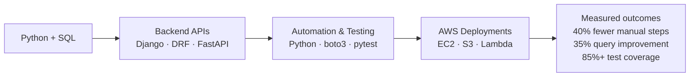

# Pavan Kalyan Buradagunta

### Python Backend & Full-Stack Developer | Django · DRF · FastAPI · SQL · AWS

  
   
  <strong>Open to entry-level Python, Backend, and Full-Stack roles in Hyderabad and across India</strong>
    
  <a href="https://www.linkedin.com/in/buradagunta-pavan-kalyan/">LinkedIn</a> ·
  <a href="https://pavan-portfolio-sage.vercel.app">Portfolio</a> ·
  <a href="mailto:pavankalyanburadagunta@gmail.com">Email</a>

---

## About

I’m a 2025 MCA graduate from MIC College of Technology, Hyderabad, focused on Python backend and full-stack development. I build REST APIs, workflow automation, and cloud-backed applications using Python, Django/DRF, FastAPI, PostgreSQL, React, and AWS.

I enjoy solving practical engineering problems, writing testable code, and turning repetitive processes into reliable systems.

## Impact at a glance

| Area | Selected results |
|---|---|
| Python automation | Built **5+ modules**, reducing manual workflow steps by **40%** (about **8 hours per week**) |
| SQL & PostgreSQL | Improved **10+ queries** by **35%** |
| Testing | Resolved **25+ bugs** with pytest regression testing; reached **85%+ test coverage** on a Django/DRF project |
| Cloud operations | Deployed applications on AWS and worked with EC2, S3, Lambda, IAM, VPC, and CloudWatch |

## How I build

## Featured projects

| Project | What it does | Stack |
|---|---|---|
| [RetailOps Full-Stack](https://github.com/pavanklyn/retailops-fullstack) | Inventory and order-management platform with a Django REST backend and React frontend | Django REST Framework, React, PostgreSQL, Docker |
| [Log File Automation System](https://github.com/pavanklyn/log-automation-system) | Monitors logs, alerts on errors, and automates archival to AWS S3 | Python, boto3, Docker, pytest |
| [Real-Time Surge Pricing Engine](https://github.com/pavanklyn/surge-pricing-engine) | ML-based dynamic pricing model with a live dashboard | Django, Streamlit, scikit-learn |
| [EAR Drowsiness Detection System](https://github.com/pavanklyn/ear-drowsiness-detector) | Detects driver drowsiness in real time using eye-aspect-ratio tracking | Python, MediaPipe, OpenCV |

## Tech stack

**Languages:** Python, JavaScript, SQL, HTML, CSS 
**Backend:** Django, Django REST Framework, FastAPI, Flask, REST APIs 
**Data:** PostgreSQL, MongoDB 
**Cloud & delivery:** AWS (EC2, S3, Lambda, IAM, VPC, CloudWatch), Docker, Git, CI/CD 
**Testing & tools:** pytest, Postman, VS Code

## GitHub activity

  
  
   
  

## Current focus

- Deepening cloud architecture, infrastructure-as-code, and system-design skills
- Building serverless projects and CI/CD workflows
- Contributing to open source and improving test automation

## Connect

- **LinkedIn:** [linkedin.com/in/buradagunta-pavan-kalyan](https://www.linkedin.com/in/buradagunta-pavan-kalyan/)
- **Portfolio:** [pavan-portfolio-sage.vercel.app](https://pavan-portfolio-sage.vercel.app)
- **GitHub:** [github.com/pavanklyn](https://github.com/pavanklyn)
- **Email:** [pavankalyanburadagunta@gmail.com](mailto:pavankalyanburadagunta@gmail.com)

  

